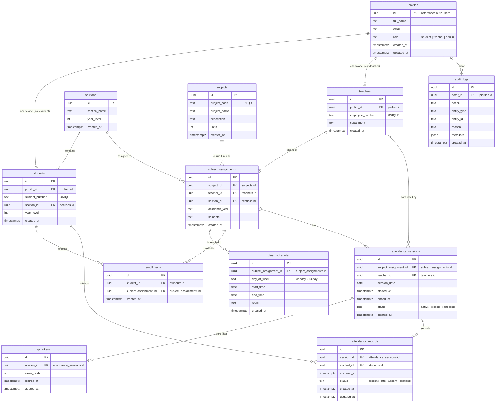

# MontaScan Database Schema Specification

This document details the PostgreSQL schema implemented in Supabase for the MontaScan attendance management system.

---

## 1. Entity-Relationship Diagram (ERD)

---

## 2. Integrity Constraints & Rules

1. **Unique Attendance**: `UNIQUE (session_id, student_id)` on `attendance_records` strictly guarantees that a student cannot have multiple records for the same session.
2. **Unique Enrollment**: `UNIQUE (student_id, subject_assignment_id)` guarantees a student cannot be doubly enrolled in the same class offering.
3. **Unique User Identification**: `student_number` and `employee_number` must be universally unique.
4. **Time & Session Validity**: `ended_at >= started_at` when closed.
5. **Cascading Behavior**:
   - Deleting a profile cascades to student or teacher record.
   - Deleting an assignment cascades to its schedules and enrollments.
   - Attendance sessions and audit logs are retained for compliance and never cascade-deleted on operational actions.
