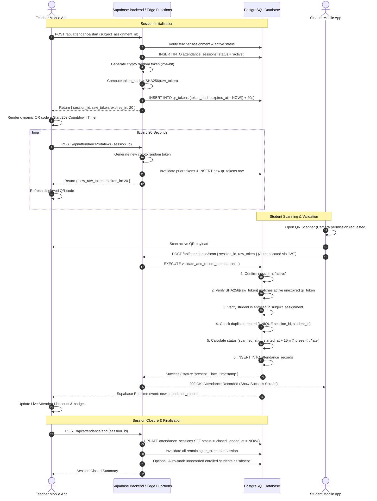

# MontaScan Dynamic QR Attendance Workflow

## 1. Sequence Diagram



---

## 2. Token Security Design

1. **Payload Specification**:
   The QR code contains a minimal, non-sensitive JSON string:
   ```json
   {
     "v": 1,
     "sid": "f3b39218-356a-4b92-91f9-54d9fb0a9967",
     "t": "a8f3b14d2e99c43b819f72e3...",
     "ts": 1731153600000
   }
   ```
2. **Zero Sensitive PII**: No student IDs, teacher IDs, grades, or passwords exist in the QR payload.
3. **One-Way Cryptographic Storage**:
   Only `SHA256(token)` is recorded in the `qr_tokens` table. Even if the database is read directly, active raw tokens cannot be reverse-engineered before their 20-second expiration.
4. **Server-Side Clock Authority**:
   All timestamps and expiration evaluations execute using PostgreSQL's server clock (`NOW()`). The student's device clock is completely ignored.
5. **Anti-Replay & Concurrency**:
   Database-level unique constraint on `(session_id, student_id)` prevents concurrent double-submission attacks.
